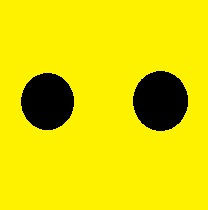
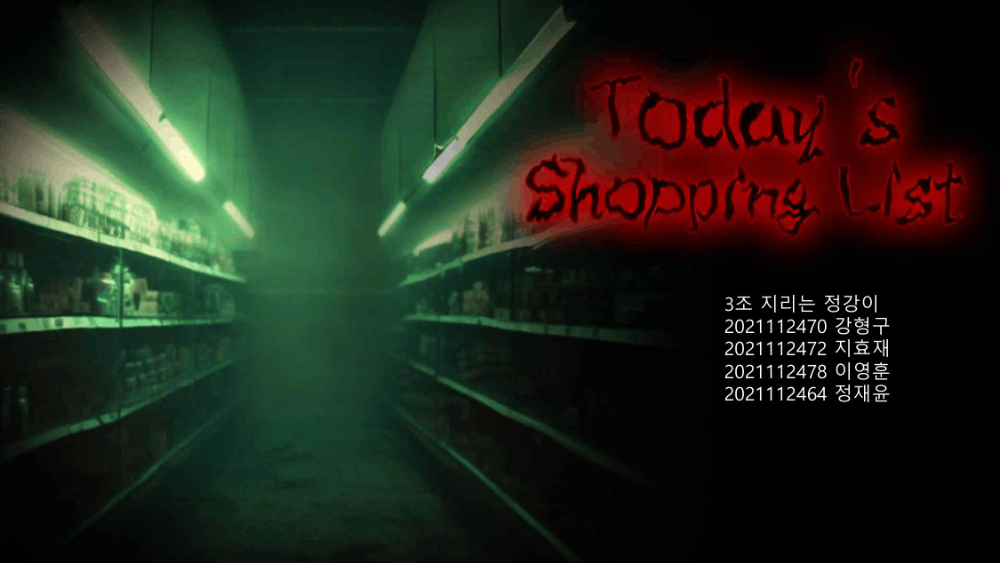
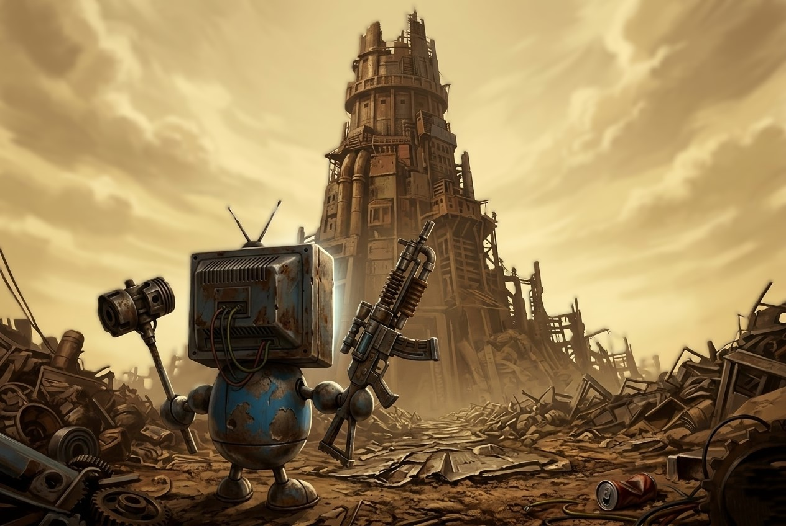
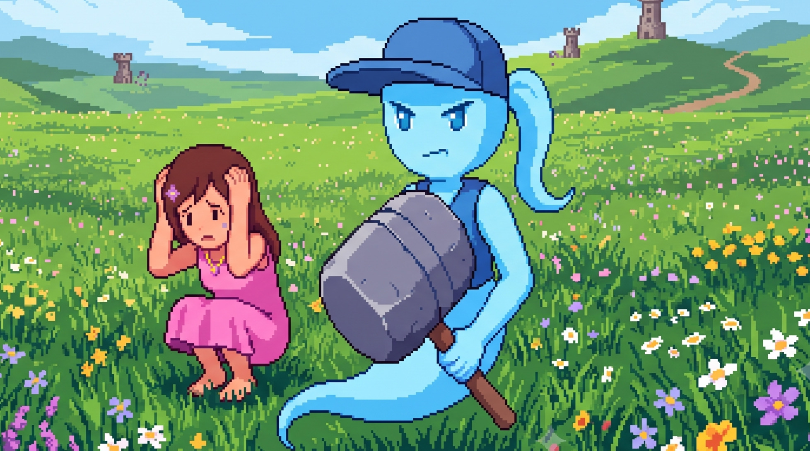

# Jae-Yun Jung

### Game Developer Portfolio

**게임을 직접 만들고, AI와 함께 더 빠르게 성장하는 개발자**

Unity와 Unreal Engine을 활용하여 다양한 장르의 게임을 제작하고 있습니다.  
플레이어 시스템, 전투, 인벤토리, 게임 AI, UI, 레벨 디자인 등  
게임 플레이 전반을 직접 구현하는 개발자를 목표로 하고 있습니다.

## About Me

동국대학교 **멀티미디어소프트웨어공학 전공**으로 게임 개발자를 목표로 공부하고 있습니다.

Unity와 Unreal Engine을 활용하여 팀 프로젝트와 개인 프로젝트를 진행했으며,  
단순히 기능을 구현하는 것에서 그치지 않고  
**플레이어가 어떤 경험을 하게 되는지 고민하며 게임 시스템과 레벨을 설계하는 것**을 중요하게 생각합니다.

최근에는 생성형 AI를 새로운 기술 학습, 코드 분석, 디버깅, 아이디어 탐색 및 프로토타이핑에 활용하며  
게임 개발 과정에서 AI를 효과적으로 활용하는 방법을 함께 학습하고 있습니다.

---

## Tech Stack

### Game Engine

### Languages

### Development

`Blueprint` `Game AI` `Inventory System` `FPS Mechanics` `Level Design` `UI / UX`

# Game Projects

<table>
<tr>
<td width="50%" align="center">

  
<b>RetroDash</b>
 
3인 팀 프로젝트
 
Unity · C#
</td>
<td width="50%" align="center">

  
<b>Today's Shopping List</b>
 
4인 팀 프로젝트
 
Unreal Engine 5 · C++ · Blueprint
</td>
</tr>
<tr>
<td width="50%" align="center">

  
<b>T-Bot</b>
 
개인 프로젝트
 
Unity · C#
</td>
<td width="50%" align="center">

  
<b>Keepmove</b>
 
개인 프로젝트 · 2 Day Prototype
 
Unity · C#
</td>
</tr>
</table>

---

# 01. RetroDash

### 2D Rhythm Bullet Hell Game

**3인 팀 프로젝트**

음악의 비트에 맞춰 다양한 장애물과 공격 패턴이 등장하는  
2D 리듬 기반 회피 게임입니다.

플레이어는 이동과 대시를 활용해 탄막을 피하고,  
아이템을 활용하면서 음악이 끝날 때까지 생존해야 합니다.

### 담당 역할

- 플레이어 시스템 구현
- 아이템 시스템 구현
- 맵 구성
- 애니메이션 배치
- 레벨 디자인

### 주요 시스템

- 타이틀 → 스테이지 선택 → 플레이 → 클리어 / 게임오버 씬 흐름
- 점탄, 레이저, 기둥, 폭탄 등 다양한 장애물 패턴
- 플레이어 위치를 기반으로 한 보스 추적 공격
- 회복 / 보호막 / 무적 / 이동속도 증가 아이템
- 피격 횟수 및 점수 기반 랭크 시스템
- 음악과 게임 진행의 동기화

### Tech

`Unity` `C#` `2D Game` `Level Design` `Game System`

### Link

[RetroDash 게임 보기](https://drive.google.com/file/d/1560znRkFTS2F37V-TcSqW4QyVaBG0k-8/view?usp=drive_link)

---

# 02. Today's Shopping List

### 3D First Person Horror Game

**4인 팀 프로젝트**

나폴리탄 괴담을 기반으로 제작한 3D 1인칭 공포 게임입니다.

플레이어는 대형 마트에서  
진실과 거짓이 동적으로 변하는 안전수칙을 확인하면서  
쇼핑 리스트에 적힌 물건을 수집해야 합니다.

스테이지가 진행될수록 새로운 몬스터와 기믹이 추가되어  
플레이어에게 점점 더 큰 심리적 압박을 주도록 설계했습니다.

### 담당 역할

- 플레이어 캐릭터
- 인벤토리 시스템
- 아이템 시스템
- 맵 구조 설계
- 스토리 배경 구성
- 몬스터 및 게임 기믹 설계

### 주요 시스템

- WASD 이동 / 달리기 / 숙이기
- 스태미너 시스템
- 36슬롯 인벤토리
- 아이템 Pickup
- Drag & Drop UI
- 동적으로 진실과 거짓이 변경되는 지침서
- 다양한 행동 패턴을 가진 몬스터
- 포스트 프로세스 기반 공포 연출
- 카메라 시퀀서를 활용한 엔딩 연출
- 스테이지별 아이템 및 난이도 구성

### Tech

`Unreal Engine 5` `C++` `Blueprint` `Inventory` `Game AI` `Level Design`

### Links

[게임 보기](https://drive.google.com/file/d/16V-nXyjkaAxpwjUAmK5hyJ511gE2Eq_T/view?usp=drive_link)

[프로젝트 PPT 보기](https://docs.google.com/presentation/d/1zKhrEZib4bScawb8hLI1ZOU2NQZLduu8/edit?usp=drive_link&ouid=102295740409891925672&rtpof=true&sd=true)

# 03. T-Bot

### FPS × Tower Defense

**개인 프로젝트**

타워 디펜스의 전략적인 포탑 배치와  
FPS 방식의 직접 전투를 결합한 하이브리드 게임입니다.

웨이브가 시작되기 전에는 탑다운 시점에서 포탑을 설치하고,  
전투가 시작되면 FPS 시점으로 전환되어  
플레이어가 직접 적과 전투합니다.

타워만 사용하거나 총만 사용하는 방식이 아니라  
두 시스템을 모두 활용해야 스테이지를 효과적으로 공략할 수 있도록 설계했습니다.

### 담당 역할

**기획 및 전체 구현**

- 플레이어
- FPS 전투 시스템
- 포탑 시스템
- 적 시스템
- 웨이브 관리
- 스테이지
- UI
- 게임 흐름
- 레벨 디자인

### 주요 시스템

- 탑다운 ↔ FPS 시점 전환
- 포탑 구매 및 배치
- 무기 구매 시스템
- 웨이브 기반 적 스폰
- 총 6개 스테이지 + 보스 스테이지
- 스테이지 해금 시스템
- 플레이어 체력 / 스태미너
- 볼륨 / 감도 / 밝기 옵션

### Tech

`Unity` `C#` `FPS` `Tower Defense` `Wave System` `Level Design`

### Link

[T-Bot itch.io](https://yoonyyun.itch.io/t-bot?secret=rKUlsPWSNJy8BAh52h0DFeOIU)

---

# 04. Keepmove

### Survivors-like × Tower Defense

**개인 프로젝트 · 2 Day Prototype**

뱀서라이크 스타일의 전투와  
타워 디펜스 요소를 결합하여 제작한 Unity 개인 프로젝트입니다.

하나의 아이디어를 짧은 시간 안에 실제로 플레이 가능한 게임으로 만드는 것을 목표로  
**2일 동안 제작한 프로토타입**입니다.

빠르게 핵심 게임 루프를 정리하고  
필요한 기능을 우선순위에 따라 구현하면서  
짧은 개발 기간 안에서 게임을 완성하는 경험을 목표로 했습니다.

### Development

- Solo Development
- Development Time : **2 Days**

### Tech

`Unity` `C#` `Prototype` `Survivors-like` `Tower Defense`

### Links

[Keepmove 게임 보기](https://drive.google.com/file/d/1AoQSw8czTDx54ZL6PKIuLVyqoniSl9bk/view?usp=drive_link)

[Keepmove 플레이 영상](https://drive.google.com/file/d/1g0WYrXBofzRgy2fbyXzDXFJxN7UmgDMa/view?usp=drive_link)

---

# AI-Assisted Game Development

게임 개발 과정에서 생성형 AI를  
단순한 코드 생성기가 아니라 **개발 과정의 보조 도구**로 활용하고 있습니다.

### 활용 분야

- 새로운 게임 시스템 아이디어 탐색
- C# / C++ 코드 분석
- 오류 원인 및 디버깅 방향 탐색
- 새로운 API와 엔진 기능 학습
- 알고리즘 및 게임 로직 개선
- 빠른 프로토타이핑

AI가 생성한 결과를 그대로 적용하기보다는  
코드가 어떤 원리로 동작하는지 확인하고  
현재 프로젝트 구조에 맞게 직접 수정하고 검증하는 것을 중요하게 생각합니다.

---

# What I Want to Build

게임의 재미를 만드는 시스템을 직접 설계하고 구현할 수 있는 개발자를 목표로 하고 있습니다.

현재까지 Unity와 Unreal Engine을 이용하여  
리듬 게임, 공포 게임, FPS, 타워 디펜스 등 다양한 장르를 경험했으며,

앞으로는 게임 개발 경험과 AI 기술을 함께 활용해  
더 효율적으로 새로운 아이디어를 실험하고  
플레이어에게 새로운 경험을 제공하는 게임을 만들고 싶습니다.

---

### Jae-Yun Jeong

Game Developer

Dongguk University  
Multimedia Software Engineering

